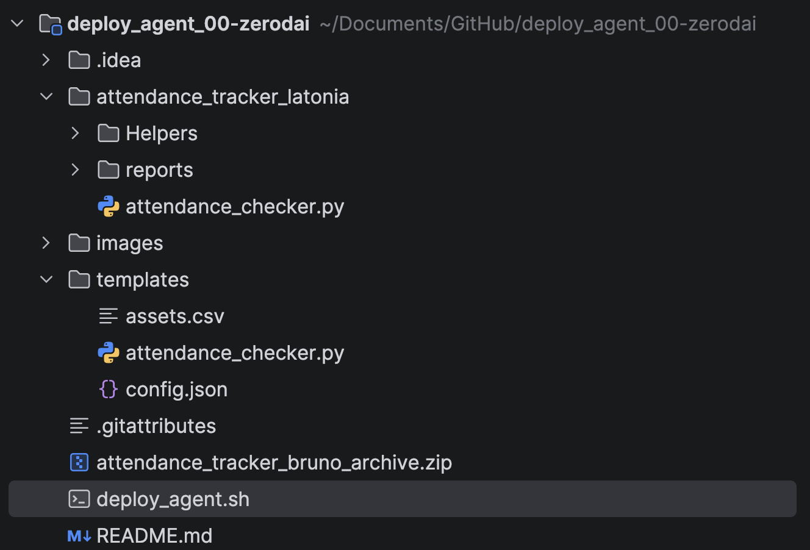
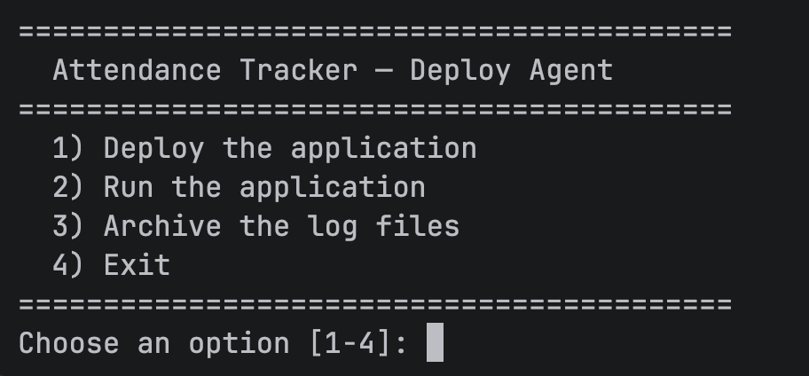
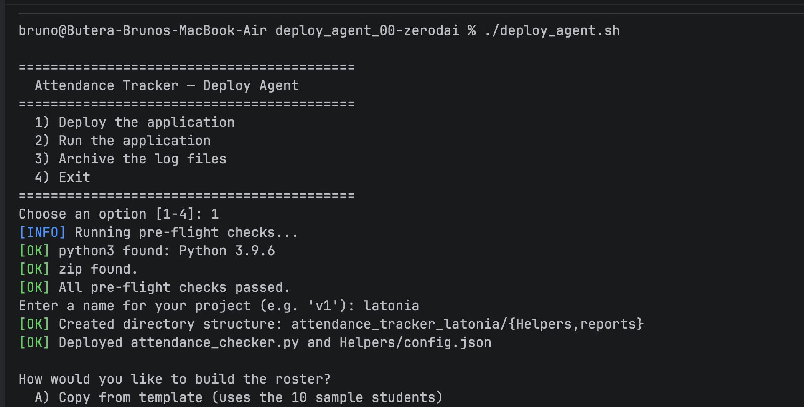
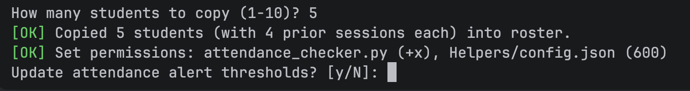
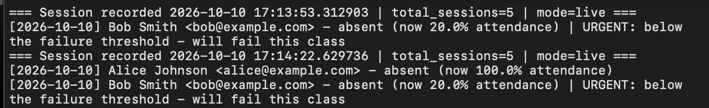
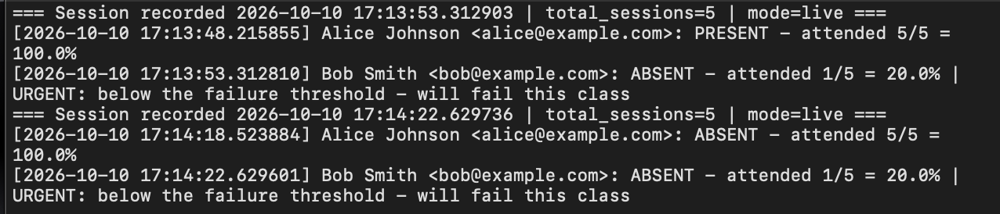
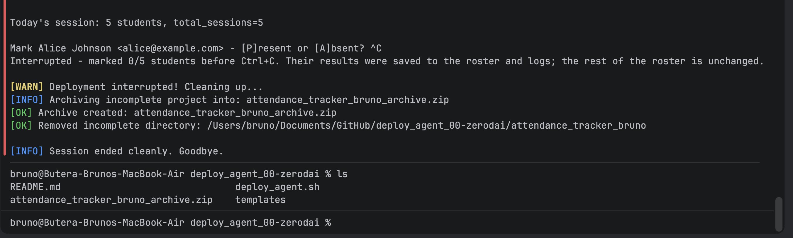

# deploy_agent

A Bash script that bootstraps, runs, and archives logs for the Student
Attendance Tracker (Python), with clean handling of Ctrl+C / Ctrl+Z
during deployment.

## Repository structure

## Requirements
- Linux/macOS/WSL with Bash
- python3
- zip

## How to run
    chmod +x deploy_agent.sh
    ./deploy_agent.sh

## I used an **interactive menu**: 

## Feature 1: Deploy
1. Pre-flight checks that python3 and zip are installed, and prints the
   python3 version. The script exits with a message if either is missing.
2. Asks for a project name and creates `attendance_tracker_<name>/` with
   `Helpers/` and `reports/`. If the directory exists, you choose to
   overwrite or abort.
3. Copies `attendance_checker.py` and `config.json` from `templates/`.
4. Builds `Helpers/assets.csv` using one of two options:
    - **Option A (copy):** copies N students (plus header) from the template.
      These rows carry 4 prior sessions, so `total_sessions` = 5.
    - **Option B (generate):** builds N students from arrays in the script,
      with counts at 0, so `total_sessions` = 1.
5. Sets permissions: `attendance_checker.py` is executable (`chmod +x`),
   `config.json` is owner read/write only (`chmod 600`).
6. Runs the app once to verify the deployment.

### Why total_sessions matters
`total_sessions` must always equal prior sessions in the roster + 1
(today's session). Option A = 5, Option B = 1.

### Threshold update
You are asked whether to update the alert thresholds. If yes, the script
prompts for `warning` (default 75) and `failure` (default 50), checks that
each input is a number, then uses `sed -i` to edit only the `"warning"` and
`"failure"` lines. The file is not reformatted or reordered.

## Feature 2: Run
Enters the project folder and runs `python3 attendance_checker.py`.
The app prompts you to mark each student present or absent, updates
`assets.csv`, and writes logs to `reports/`.

## Feature 3: Archive logs
After a run, the script checks for `reports/attendance.log` and
`reports/absent.log`. Each existing log is archived with a timestamp:

    archives/attendance/attendance_YYYYMMDD_HHMMSS.log
    archives/absent/absent_YYYYMMDD_HHMMSS.log

If a log is missing (e.g. nobody was absent), the script reports it and
continues without crashing. Final paths are printed.

## Signal handling (Ctrl+C / Ctrl+Z)
During deployment, `SIGINT` and `SIGTSTP` are trapped. On interrupt, the script:
1. Prints that deployment was interrupted.
2. Zips what exists so far into `attendance_tracker_<name>_archive.zip`.
3. Deletes the incomplete project directory.
4. Exits cleanly.

The trap applies only to the shell script, not to the marking session.

### How to test it
1. Run `./deploy_agent.sh` and choose Deploy.
2. At any prompt (e.g. the student count), press Ctrl+C or Ctrl+Z.
3. Check that the `.zip` exists (`ls`) and that the project directory is gone.
4. Inspect the zip contents with `unzip -l attendance_tracker_<name>_archive.zip`.
   It contains whatever had been created before the interrupt.

## How I tested the deployment
- Ran both Option A and Option B and checked the tree with `ls -R`.
- Checked permissions with `ls -l` (`-rwx...` on the .py file, `-rw-------` on config.json).
- Checked `total_sessions` against the roster.
- Entered invalid thresholds (letters, empty) to confirm they are rejected.
- Ran the app, marked students, then archived. Tested the case where no
  absent.log exists.
- Tried deploying into an existing directory (overwrite and abort).

# Video
